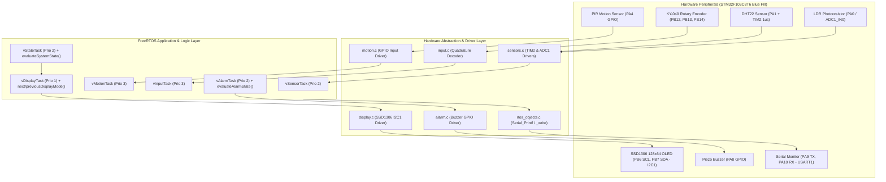
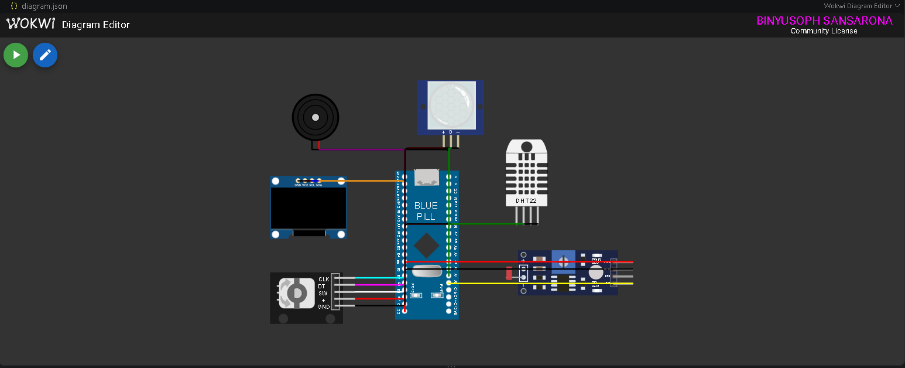
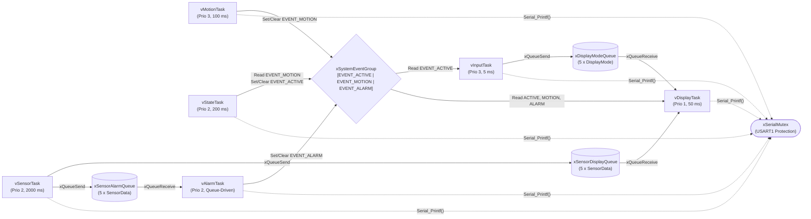
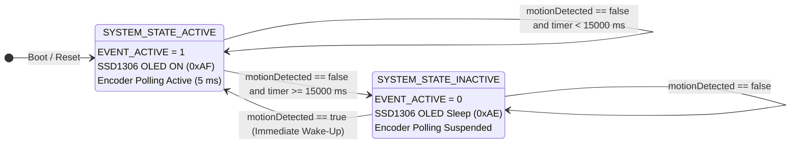
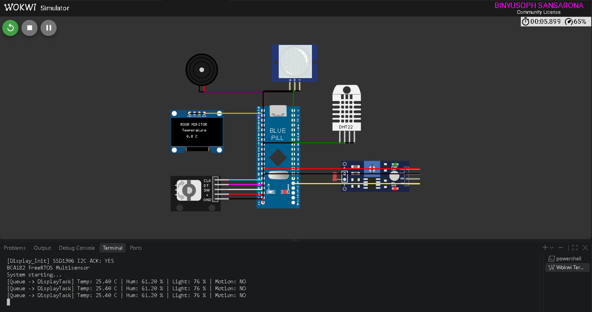

# FreeRTOS Multisensor Room Monitoring System (STM32F103C8T6)

## Project Overview
The **FreeRTOS Multisensor Room Monitoring System** is a deterministic, real-time multitasking embedded firmware application engineered for the **STM32F103C8T6 (Blue Pill)** ARM Cortex-M3 microcontroller using **FreeRTOS** and the **STM32Cube HAL** framework. The system continuously acquires environmental telemetry (ambient temperature, relative humidity, and light intensity) alongside room occupancy status, renders user-navigable telemetry pages on an I2C SSD1306 OLED display, triggers an audible threshold alarm on thermal anomalies, and executes an automated occupancy-driven power-saving state machine.

## Features
- **Deterministic 6-Task FreeRTOS Architecture:** Preemptive priority-based scheduling separating time-critical user/motion inputs, periodic sensor sampling, threshold alarm evaluation, state management, and I2C OLED rendering.
- **Multisensor Telemetry Acquisition:** Single-wire microsecond-timed DHT22 temperature/humidity sensing (`TIM2`) paired with 12-bit ADC photoresistor (LDR) ambient light measurement (`ADC1_IN0`).
- **Interactive Rotary Encoder UI:** Quadrature state-table decoding of a KY-040 rotary encoder supporting wraparound clockwise (`CW`) and counter-clockwise (`CCW`) navigation across 4 telemetry pages.
- **Automated Thermal Alarm:** Real-time evaluation against configurable lower (`18.0 C`) and upper (`30.0 C`) temperature bounds driving a piezo buzzer (`PA8`) and system alarm event bit.
- **Occupancy Power State Machine:** Automatic transition from `ACTIVE` to `INACTIVE` (OLED display hardware sleep) after `15000 ms` of no PIR motion, with instant wake-up upon occupancy detection.
- **Thread-Safe RTOS Synchronization:** Zero-global-variable data flow utilizing FreeRTOS Queues, an Event Group, and a UART Mutex Semaphore.
- **Verified Code Quality:** Validated via 14 host-based Unity unit tests (`pio test`), zero-defect Cppcheck static code analysis (`pio check`), and 10 end-to-end Wokwi hardware simulation tests.

## Learning Objectives
- Design and partition a real-time embedded application into cooperative and preemptive FreeRTOS tasks with justified priority assignments.
- Implement thread-safe inter-task communication using FreeRTOS Queues (`xQueueSend`, `xQueueReceive`, `xQueueOverwrite`).
- Synchronize system-wide operational modes and hardware access using FreeRTOS Event Groups (`EventGroupHandle_t`) and Mutex Semaphores (`SemaphoreHandle_t`).
- Decouple pure application decision logic (alarm thresholds, UI navigation, state transitions) from STM32 HAL hardware drivers to enable host-based unit testing (`native` Unity framework).
- Enforce embedded software quality through static code analysis (`cppcheck`), structured functional verification, and disciplined Git version control.

## System Architecture
The system follows a layered hardware-independent architecture separating pure application logic from FreeRTOS synchronization primitives and STM32Cube HAL peripheral drivers:



## FreeRTOS Architecture
The firmware runs on the FreeRTOS kernel configured with preemptive scheduling (`configUSE_PREEMPTION = 1`), a `1000 Hz` system tick (`1 ms` resolution), `10 KB` heap allocation (`heap_4.c`), and runtime safety hooks (`vApplicationStackOverflowHook` and `vApplicationMallocFailedHook`).

## Hardware / Simulated Components
- **Microcontroller:** STM32F103C8T6 "Blue Pill" (ARM Cortex-M3 @ 72 MHz, 64 KB Flash, 20 KB SRAM) (`board-stm32-bluepill`)
- **Temperature & Humidity Sensor:** DHT22 Digital Sensor (`wokwi-dht22`)
- **Ambient Light Sensor:** Photoresistor (LDR) Module (`wokwi-photoresistor-sensor`)
- **Display:** SSD1306 128x64 Monochrome I2C OLED (`board-ssd1306`)
- **User Input:** KY-040 Incremental Rotary Encoder (`wokwi-ky-040`)
- **Occupancy Sensor:** HC-SR501 PIR Motion Sensor (`wokwi-pir-motion-sensor`)
- **Audible Indicator:** Piezoelectric Buzzer (`wokwi-buzzer`)

### Wokwi Circuit Schematic


## Pin Configuration
| Component | Wokwi Part | STM32 Pin(s) | Peripheral / Mode | Function |
| :--- | :--- | :--- | :--- | :--- |
| **DHT22 Sensor** | `wokwi-dht22` | `PA1` | GPIO Open-Drain + `TIM2` (1 us) | Temperature (C) & Humidity (%) |
| **LDR Sensor** | `wokwi-photoresistor-sensor` | `PA0` (`AO`) | `ADC1_IN0` (12-bit, 0-4095) | Ambient light percentage (0-100%) |
| **SSD1306 OLED** | `board-ssd1306` | `PB6` (SCL), `PB7` (SDA) | `I2C1` (400 kHz Fast Mode, `0x3C`) | 4-page user telemetry screen |
| **KY-040 Encoder** | `wokwi-ky-040` | `PB12` (CLK), `PB13` (DT), `PB14` (SW) | GPIO Input with Pull-Up | CW / CCW display page navigation |
| **Piezo Buzzer** | `wokwi-buzzer` | `PA8` | GPIO Output Push-Pull | Low/High temperature alarm indicator |
| **PIR Sensor** | `wokwi-pir-motion-sensor` | `PA4` | GPIO Input with Pull-Down | Room occupancy detection & wake-up |
| **Serial Monitor** | `USART1` | `PA9` (TX), `PA10` (RX) | UART 115200 8N1 | Mutex-protected diagnostic logging |

## Task Design
| Task Name | Priority | Stack (Words / Bytes) | Timing / Trigger | Core Responsibility & Priority Justification |
| :--- | :--- | :--- | :--- | :--- |
| **`vMotionTask`** | 3 (Highest) | 192 (768 B) | `100 ms` (`vTaskDelay`) | Polls `PA4` PIR input and updates `EVENT_MOTION`. Highest priority guarantees occupancy wake-up events are never missed. |
| **`vInputTask`** | 3 (Highest) | 192 (768 B) | `5 ms` (`vTaskDelay`) | Samples `PB12`/`PB13` quadrature transitions when `EVENT_ACTIVE` is set. High priority at 5 ms prevents missed mechanical rotary detents. |
| **`vSensorTask`** | 2 (Medium) | 384 (1536 B) | `2000 ms` (`vTaskDelayUntil`) | Acquires DHT22 and LDR readings every 2 s and publishes `SensorData` to display and alarm queues. |
| **`vAlarmTask`** | 2 (Medium) | 384 (1536 B) | Queue-driven (`portMAX_DELAY`) | Blocks on `xSensorAlarmQueue`, evaluates thresholds (`18.0 C` - `30.0 C`), drives `PA8` buzzer, and updates `EVENT_ALARM`. |
| **`vStateTask`** | 2 (Medium) | 256 (1024 B) | `200 ms` (`vTaskDelay`) | Evaluates `EVENT_MOTION` and the `15000 ms` inactivity timer via `evaluateSystemState()`, setting or clearing `EVENT_ACTIVE`. |
| **`vDisplayTask`** | 1 (Lowest) | 384 (1536 B) | Queue / Event (`50 ms`) | Sole owner of `I2C1` SSD1306 OLED; renders active telemetry page or powers down display when `INACTIVE`. Lowest priority prevents I2C frames from blocking inputs or sensors. |

## Inter-Task Communication
- **`xSensorDisplayQueue` (`QueueHandle_t`, Depth 5, `sizeof(SensorData)`):** Passes periodic environmental snapshots from `vSensorTask` to `vDisplayTask`.
- **`xSensorAlarmQueue` (`QueueHandle_t`, Depth 5, `sizeof(SensorData)`):** Delivers every temperature sample from `vSensorTask` to `vAlarmTask` for deterministic alarm evaluation.
- **`xDisplayModeQueue` (`QueueHandle_t`, Depth 5, `sizeof(DisplayMode)`):** Sends user-selected page changes (`DISPLAY_MODE_TEMPERATURE`, `HUMIDITY`, `LIGHT`, `MOTION`) from `vInputTask` to `vDisplayTask`.
- **`xSystemEventGroup` (`EventGroupHandle_t`):** Coordinates system-wide state flags across all tasks (`EVENT_ACTIVE`, `EVENT_MOTION`, `EVENT_ALARM`).
- **`xSerialMutex` (`SemaphoreHandle_t`):** Protects `USART1` (`Serial_Printf`) against interleaved strings from concurrent tasks.

### FreeRTOS Task-Communication Diagram


## State Machine
The system state machine (`evaluateSystemState()` in `src/system_state.c`) manages transitions between `SYSTEM_STATE_ACTIVE` and `SYSTEM_STATE_INACTIVE`:



## Repository Structure
```text
.
|-- docs/
|   `-- images/
|       |-- wokwi_circuit.png     # Wokwi circuit schematic image
|       `-- finished_system.png   # Running simulation & OLED output screenshot
|-- include/
|   |-- FreeRTOSConfig.h          # FreeRTOS kernel configuration
|   |-- alarm.h                   # Temperature alarm thresholds & API
|   |-- app_types.h               # Shared telemetry & state data structures
|   |-- display.h                 # SSD1306 OLED driver & page navigation API
|   |-- input.h                   # KY-040 rotary encoder task & polling API
|   |-- motion.h                  # PIR motion sensor task API
|   |-- rtos_objects.h            # Queues, Event Group, and UART Mutex handles
|   |-- sensors.h                 # DHT22 & LDR acquisition task API
|   |-- stm32_assert.h            # HAL / RTOS assertion hooks
|   `-- system_state.h            # Occupancy state machine API
|-- src/
|   |-- alarm.c                   # Alarm evaluation logic & vAlarmTask
|   |-- display.c                 # I2C1 SSD1306 driver, UI renderer & vDisplayTask
|   |-- input.c                   # Quadrature decoder & vInputTask
|   |-- main.c                    # System clock, UART1, peripheral init & scheduler start
|   |-- motion.c                  # PIR GPIO polling & vMotionTask
|   |-- rtos_objects.c            # RTOS primitive initialization & Serial_Printf mutex wrapper
|   |-- sensors.c                 # TIM2 DHT22 driver, ADC1 LDR driver & vSensorTask
|   `-- system_state.c            # State transition evaluator & vStateTask
|-- test/
|   |-- test_alarm/               # 5 Unity unit tests for temperature threshold boundaries
|   |-- test_navigation/          # 4 Unity unit tests for CW/CCW display mode wraparound
|   `-- test_state/               # 5 Unity unit tests for ACTIVE/INACTIVE timeout & wake-up
|-- diagram.json                  # Wokwi hardware schematic & pin wiring definition
|-- platformio.ini                # PlatformIO target (bluepill_f103c8) & native test config
|-- wokwi.toml                    # Wokwi firmware binary linkage configuration
`-- README.md                     # Public portfolio technical documentation
```

## Getting Started
1. **Prerequisites:**
   - [Visual Studio Code](https://code.visualstudio.com/) with the **PlatformIO IDE** and **Wokwi Simulator** extensions installed.
   - **MinGW-w64 / GCC** installed on the host machine (for running `native` Unity unit tests).
2. **Clone the Repository:**
```powershell
git clone [https://github.com/BinSan21/FreeRTOS_Room_Monitoring_Multisensor.git](https://github.com/BinSan21/FreeRTOS_Room_Monitoring_Multisensor.git)
cd FreeRTOS_Room_Monitoring_Multisensor
```

## Building the Project
Compile the STM32F103C8T6 firmware binary (`.pio/build/bluepill_f103c8/firmware.elf` and `firmware.bin`) via PlatformIO CLI:
```powershell
pio run -e bluepill_f103c8
```
- **RAM Utilization:** `80.1%` (`16,404 / 20,480 bytes`)
- **Flash Utilization:** `50.9%` (`33,368 / 65,536 bytes`)

## Running the Wokwi Simulation
1. Build the firmware first (`pio run -e bluepill_f103c8`).
2. Open `diagram.json` in Visual Studio Code.
3. Click the green **Start Simulation** play button in the Wokwi editor.
4. Click the **DHT22**, **LDR**, **PIR Motion Sensor**, or **KY-040 Rotary Encoder** components during simulation to dynamically adjust environmental inputs and verify real-time OLED and UART responses.

## Unit Testing
Pure application logic is decoupled from STM32 HAL headers (`#ifndef UNIT_TEST`) and verified on the host PC using the **Unity** test framework across 3 suites (14 total test cases):
```powershell
pio test -e native
```

| Test Suite | Test Cases | Verified Logic | Status |
| :--- | :--- | :--- | :--- |
| **`test_alarm`** | 5 / 5 | `evaluateAlarmState()` at `17.9 C`, `18.0 C`, `25.4 C`, `30.0 C`, `30.1 C` | **PASSED** |
| **`test_navigation`** | 4 / 4 | `nextDisplayMode()` and `previousDisplayMode()` forward/reverse & wraparound | **PASSED** |
| **`test_state`** | 5 / 5 | `evaluateSystemState()` across `14999 ms`, `15000 ms`, motion hold, and wake-up | **PASSED** |

## Static Code Analysis
Static analysis is performed using **Cppcheck** via PlatformIO's inspection tool:
```powershell
pio check -e bluepill_f103c8
```

| Initial Finding | Location | Root Cause | Resolution |
| :--- | :--- | :--- | :--- |
| `unusedFunction: Display_RenderTemperature` | `src/display.c:273` | Obsolete single-page helper superseded by `Display_RenderScreen()`. | Removed unused declaration and definition from `display.h` and `display.c`. |
| `unusedFunction` (Cross-Module APIs & RTOS Hooks) | `src/*.c` | Single-translation-unit scan lacks whole-program linker visibility across `main.c` and FreeRTOS kernel hooks. | Verified all public APIs and RTOS hooks (`_write`, `vApplication*Hook`); configured `check_src_filters` and `--suppress=unusedFunction` in `platformio.ini`. |

**Post-Resolution Result:** `0 defects found (0 High, 0 Medium, 0 Low) [PASSED]`.

## Functional Verification
| Test ID | Description | Expected Behavior | Observed Result | Status |
| :--- | :--- | :--- | :--- | :--- |
| **FT-01** | Temperature display | Valid reading on OLED & UART every 2 s | `25.4 C` displayed on OLED and logged via UART | **PASS** |
| **FT-02** | Humidity display | Valid reading on Humidity page | `61.2 %` displayed on OLED `Humidity` page | **PASS** |
| **FT-03** | Light display | Valid percentage (`0-100%`) on Light page | `76 %` displayed and updates with LDR slider | **PASS** |
| **FT-04** | Encoder clockwise (`CW`) | Cycles `Temp -> Hum -> Light -> Motion -> Temp` | Forward cycling and wraparound verified | **PASS** |
| **FT-05** | Encoder counter-clockwise (`CCW`) | Cycles `Temp -> Motion -> Light -> Hum -> Temp` | Reverse cycling and wraparound verified | **PASS** |
| **FT-06** | Low-temperature alarm | Buzzer ON & `EVENT_ALARM` set below `18.0 C` | Alarm triggered below `18.0 C` | **PASS** |
| **FT-07** | High-temperature alarm | Buzzer ON & `EVENT_ALARM` set above `30.0 C` | Alarm triggered above `30.0 C` | **PASS** |
| **FT-08** | PIR motion detection | `EVENT_MOTION` set & `DETECTED` shown on OLED | Immediate state update on PIR trigger | **PASS** |
| **FT-09** | Inactivity timeout (`15 s`) | Enters `INACTIVE` & blanks OLED after `15000 ms` | OLED blanked and logged at `15000 ms` | **PASS** |
| **FT-10** | Motion wake-up | PIR trigger restores `ACTIVE` & wakes OLED | System restored to `ACTIVE` and OLED woken | **PASS** |

### Finished-System Simulation Screenshot


## Engineering Decisions
- **Dedicated `I2C1` Ownership in `vDisplayTask`:** Instead of sharing an I2C bus mutex across multiple tasks, `vDisplayTask` is the sole hardware owner of `I2C1`. Other tasks publish state updates via queues and event bits, eliminating I2C bus contention and priority inversion.
- **Dual Sensor Queues (`xSensorDisplayQueue` & `xSensorAlarmQueue`):** Decouples high-priority thermal safety checks (`vAlarmTask`) from lower-priority UI rendering (`vDisplayTask`) so neither task consumes data intended for the other.
- **Bit-Banged DHT22 with Critical-Section Timing (`TIM2`):** Uses a `1 MHz` hardware timer (`1 us` tick) and brief interrupt masking during the 40-bit pulse window to prevent FreeRTOS context switches from corrupting microsecond pulse-width measurements.
- **Hardware-Agnostic Pure Functions for Unit Testing:** Core decision functions (`evaluateAlarmState`, `nextDisplayMode`, `previousDisplayMode`, `evaluateSystemState`) accept primitive types and enums with zero HAL dependencies, allowing fast, deterministic execution under `pio test -e native`.

## Limitations
- **Polling-Based Rotary Encoder & PIR Inputs:** `vInputTask` (`5 ms`) and `vMotionTask` (`100 ms`) use periodic GPIO polling rather than hardware external interrupts (`EXTI`), consuming minor CPU cycles while active.
- **Simulated Sensor Timing:** In Wokwi simulation, the DHT22 and LDR exhibit idealized signal transitions without physical sensor noise or ADC impedance droop.
- **OLED Power Down vs. MCU Stop Mode:** In the `INACTIVE` state, the SSD1306 OLED controller is placed into hardware sleep (`0xAE`), while the STM32F103C8T6 core remains in the FreeRTOS idle loop rather than deep `STOP`/`STANDBY` silicon sleep so periodic background temperature alarm monitoring remains uninterrupted.

## Future Improvements
- **Interrupt-Driven Wake-Up & Encoder Decoding (`EXTI`):** Migrate PIR motion detection and KY-040 rotary encoder signals to `EXTI` hardware interrupts using `xTaskNotifyFromISR()` and `xEventGroupSetBitsFromISR()` to eliminate polling overhead.
- **Tickless Idle Power Management (`configUSE_TICKLESS_IDLE`):** Enable FreeRTOS tickless idle mode (`__WFI()`) during `SYSTEM_STATE_INACTIVE` to further reduce MCU core current consumption between 2-second sensor samples.
- **Non-Volatile Alarm Threshold Storage:** Store user-adjustable temperature alarm thresholds in STM32 internal Flash or I2C EEPROM so custom limits persist across power cycles.
- **Hardware Watchdog (`IWDG`):** Integrate the STM32 Independent Watchdog peripheral to automatically recover the system in the event of a hardware bus lockup.

## References and Acknowledgments
- **Laboratory Manual:** *BCA182 — FreeRTOS Multisensor Room Monitor Laboratory Manual*, prepared by **Asst. Prof. Paul Rodolf P. Castor, M.Sc.** (September 2026).
- **RTOS Documentation:** [FreeRTOS Kernel Developer Guide & API Reference](https://www.freertos.org/Documentation/RTOS_book.html).
- **MCU Reference:** STMicroelectronics *RM0008 Reference Manual — STM32F101xx, STM32F102xx, STM32F103xx Advanced ARM-based 32-bit MCUs*.
- **Testing & Tooling:** [PlatformIO Embedded Development Ecosystem](https://docs.platformio.org/), [ThrowTheSwitch Unity Test Framework](https://github.com/ThrowTheSwitch/Unity), [Cppcheck Static Analysis Tool](https://cppcheck.sourceforge.io/), and [Wokwi Embedded Simulator](https://docs.wokwi.com/).
